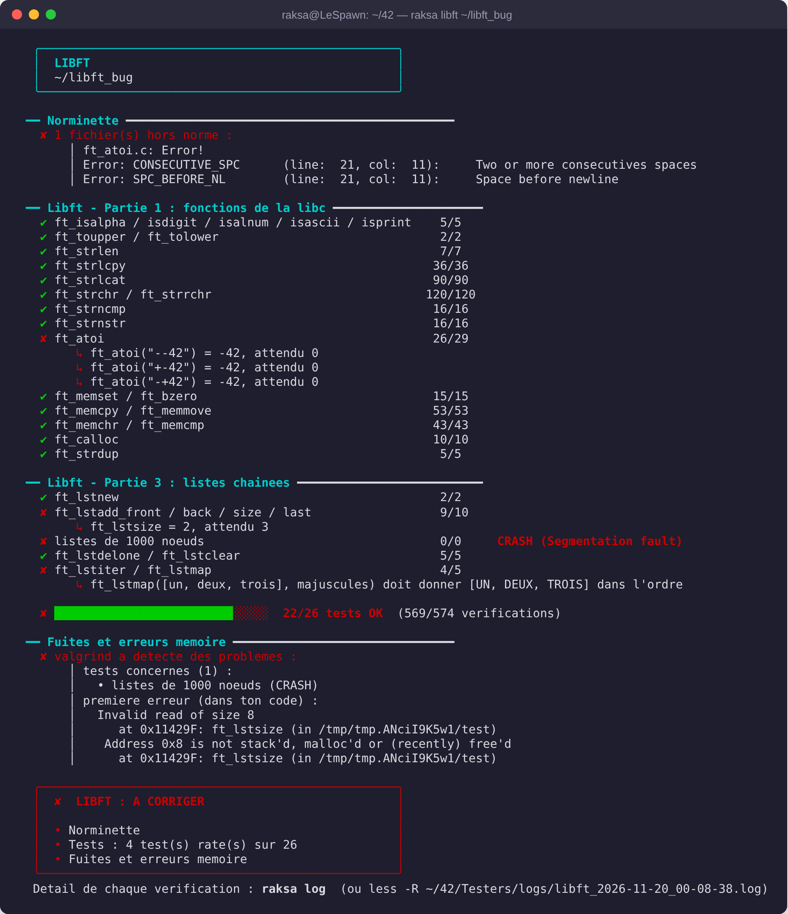
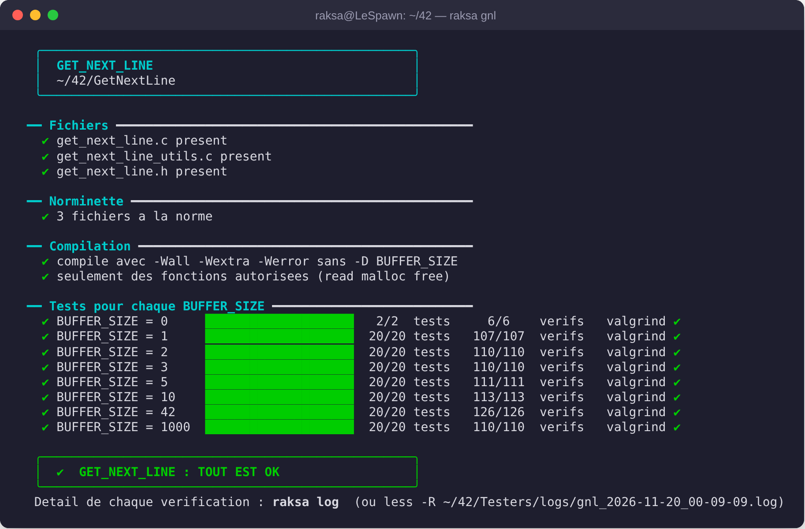
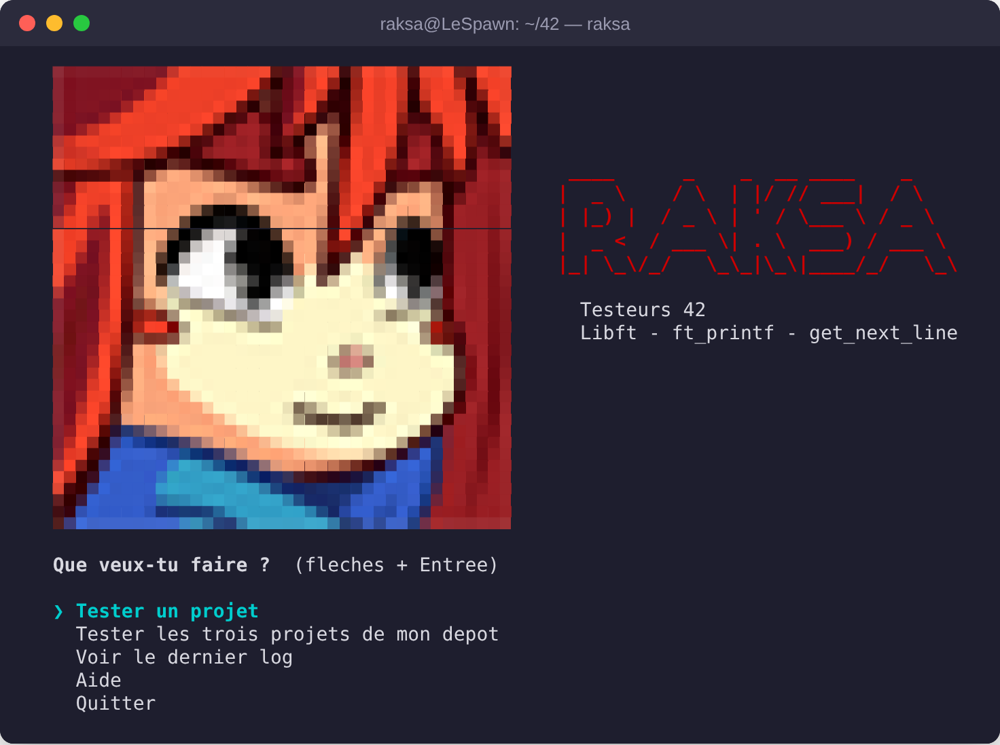
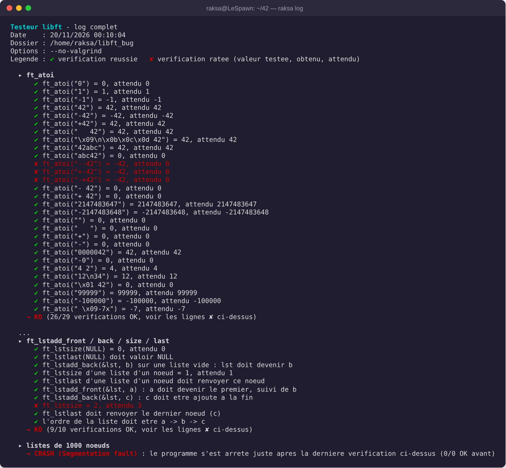

# Testers

Testers for my 42 projects. Each tester checks what will be submitted (files, README, 42
header), the Makefile and the Norm, runs the tests, then checks for memory leaks with
`valgrind`. It can also simulate a peer-evaluation and give an estimated grade.

| Folder | Project tested | What is checked |
|---|---|---|
| `libft/` | [Libft](../Libft) | Makefile (rules, flags, no relink), Norm, allowed functions only, the 43 functions compared with the libc or with the expected result (about 600 checks: limits like `INT_MIN`, `'\0'`, size 0, empty strings, `SIZE_MAX`, lists of 1000 nodes), leaks |
| `printf/` | [ft_printf](../Printf) | Makefile, Norm, allowed functions only, every conversion (`cspdiuxX%`) compared with the real `printf`, output **and** return value (about 450 checks: all ASCII characters, `INT_MIN`/`INT_MAX`/`UINT_MAX`, `NULL` strings and pointers, mixed conversions), leaks |
| `gnl/` | [get_next_line](../GetNextLine) | Norm, allowed functions only, compilation with and without `BUFFER_SIZE`, `BUFFER_SIZE` from 0 to 1000: empty file, with or without a final `\n`, empty lines, very long lines, lines of `BUFFER_SIZE - 1`, `BUFFER_SIZE` and `BUFFER_SIZE + 1` characters, a 2000-line file, standard input (all at once or slowly, in small pieces), invalid fds, calls after the end of the file, leaks |
| `push_swap/` | push_swap | Group README (2 logins, contributions, algorithms, thresholds, complexities), Makefile (relink, libft compiled with its own Makefile), Norm, allowed functions, no global variable. With its own checker: errors (`Error` on stderr), already sorted input (no operation), every permutation of 2 to 5 numbers, `INT_MIN`/`INT_MAX`, each strategy (`--simple`, `--medium`, `--complex`, `--adaptive`, none) up to 500 numbers, exact `--bench` statistics (disorder, strategy and class, counts), the right method for each disorder level, performance on 100 and 500 numbers with the subject's levels, measured growth of each strategy, `valgrind` on the program (errors included) |

## Preview

| A project with errors | A project that passes |
|---|---|
|  |  |

## Installation

Run once, from the root of the repository:

```bash
./Testers/install.sh
```

It installs a `raksa` command (a link in `~/.local/bin`), so the testers can be run from any
folder. Open a new terminal after the installation. If the repository is moved, run
`install.sh` again.

## Usage

Type `raksa` to open the menu. Choose with the **arrow keys** (or `j`/`k`, or the number of
the line) and confirm with **Enter**.



It asks step by step:

1. what to do: test one project, simulate a peer-evaluation, test all the projects of this
   repo, show the last log, or show the help;
2. if a project is found in the current folder, whether to test it;
3. otherwise, which project and which folder: the current folder, the one of this repo, or
   any other path;
4. all the tests or only one function (you type its name, for example `ft_split`);
5. whether to look for memory leaks with `valgrind`;
6. after the test: show the log, run it again, go back to the menu, or quit.

The tests can also be started directly, without the menu:

```bash
raksa ici [function]                # tests the project of the current folder
raksa libft [folder] [function]     # tests a Libft (the one of this repo by default)
raksa printf [folder] [function]    # tests a ft_printf
raksa gnl [folder] [function]       # tests a get_next_line
raksa push_swap [folder] [function] # tests a push_swap
raksa eval [project|ici] [folder]   # simulates a peer-evaluation, with an estimated grade
raksa all                           # tests all the projects of this repo
raksa log                           # shows the log of the last test
raksa --no-valgrind                 # faster, without the leak check
raksa -h                            # help
```

The project folder can be anywhere, for example a copy of the Libft inside another
project, or the folder of a 42 submission repository.

`[function]` runs only the tests whose name contains it, which is useful to check a fix
quickly: `raksa libft ft_split`, `raksa ici atoi`, `raksa printf %x`, `raksa gnl stdin`.
The `ft_` prefix and the case do not matter. If nothing matches, the list of the tests is
shown.

Without the installation, the scripts can also be run directly:

```bash
./Testers/run_all.sh
./Testers/libft/run.sh [--no-valgrind] [--eval] [--only=ft_split]
```

## What is checked

**Submission** (from the "Files to submit" and "Readme Requirements" parts of the subjects):

- the required files are there (and, in a git repository, added to git);
- no file that should not be submitted: `.o`, `.a`, `a.out`, executables,
  `Zone.Identifier`, `.swp`... In a git repository, only the files tracked by git are
  checked, since this is what the evaluator will see;
- files that are not in the subject's list are reported;
- `README.md`: the first line in italics (*This activity has been created as part of the 42
  curriculum by login.*), the Description, Instructions and Resources sections, and how AI
  was used;
- the 42 header in every `.c` and `.h`, with the right file name and the same login
  everywhere (and the same as in the README).

**Makefile**: `$(NAME)`, `all`, `clean`, `fclean` and `re` rules, `-Wall -Wextra -Werror`,
`cc`, no relink, no wildcard (`*.c`).

**Code**: Norm, every requested function present, only allowed functions, no global
variable (get_next_line), then the tests and `valgrind`.

## push_swap

The tester runs `push_swap` and checks its output with its own checker (the `checker_linux`
of the evaluation is not needed). For a failed sort, the full input is saved in
`Testers/logs/push_swap_echec_*.txt`, to replay it: `./push_swap $(cat that_file)`.

- Some behaviours are not fixed by the subject (an empty argument, `"3 2 1"` in a single
  argument, an option after the numbers...): they only give a warning `!`, but the program
  must not crash.
- "Performance" shows the average, best and worst number of operations, and the level
  reached (excellent, good, valid). The worst case must be under the "valid" limit.
- "Measured complexity" runs each strategy on 100 and 400 numbers and shows how fast the
  number of operations grows: about n² for `--simple`, n√n for `--medium`, n log n for
  `--complex`. A warning is shown if a strategy grows faster than its class.
- The project folder is `Push_swap/` in this repo by default: change `REPO_DIR` in
  `push_swap/project.conf` if yours has another name, and `DETECT` if your header is not
  `push_swap.h`.

## Simulating a peer-evaluation

`raksa eval` (or "Simuler une correction" in the menu) checks everything, with `valgrind`,
and ends with an evaluation sheet and an estimated grade:

- an error in the preliminary part (files, README, header, Norm, Makefile, compilation,
  forbidden function) gives 0, as in a real evaluation;
- a crash, an infinite loop or a memory leak gives 0;
- a failed test also gives 0: one function that does not work is usually enough for that.

It is only an estimation: the evaluator can test other cases, ask you to explain your code,
or ask for a small modification.

## Comparing with the last run

Each run is compared with the previous one on the same folder. The testers show what
**does not pass anymore** (a change broke something) and what has been **fixed**. The results
are kept in `Testers/logs/etat/`.

## Logs

Each run writes a log file in `Testers/logs/`, named after the project and the date
(for example `libft_2026-11-19_14-30-00.log`). `Testers/logs/dernier.log` always points to
the last one.

On screen, each group of tests has one line (✔ or ✘, with the number of checks that
passed), followed by the errors when it fails, and a final box says whether everything is OK
or lists what has to be fixed. For get_next_line, there is one line per `BUFFER_SIZE` with a
progress bar.

The log shows **every check**, with the values used, in colour:



For a failed check, it gives the value tested, the expected result and the obtained result.
For a crash, a timeout or a leak, it says after which check it happened. The log also
contains the output of `make`, `norminette`, the compiler and the full output of `valgrind`
(on screen, only the tests concerned and the first error, in your own functions).

The log keeps the colours, so read it with `raksa log`, the "Voir le log" line of the menu,
or `less -R Testers/logs/dernier.log` (`q` to quit, `/` to search, for example `/✘`).
Opened in vim or another editor, the colour codes show as `^[[32m`.
The `logs/` folder is in `.gitignore`, so the logs are not pushed.

## How it works

- Each test runs in its own process: a crash (`[CRASH]`) or an infinite loop (`[TIMEOUT]`)
  does not stop the other tests.
- When a test fails, the first errors are shown under it (expected value and obtained
  value); all of them are in the log.
- The leak check is skipped if `valgrind` is not installed, and the Norm check if
  `norminette` is not installed.
- If `libft.a` or `libftprintf.a` did not exist before the test, `make fclean` is run at the
  end, so no `.o` or `.a` file is left in the project folder.

## Adding a tester for a new project

The menu and `raksa all` find the projects by themselves: each folder with a `project.conf`
is a project. For a project that builds a library with a Makefile:

1. copy `Testers/_modele/` to a new folder, for example `Testers/pipex/`
   (folders starting with `_` are ignored);
2. fill in `project.conf`: name, folder in the repo, header used to recognise the project,
   name of the library, files to submit, allowed functions, requested functions;
3. write the tests in the `.c` file, with `run_test("name", function)` and
   `CHECK(condition, "message with the values", ...)`;
4. run `raksa`: the new project is in the menu.

`run.sh` uses `common/run_lib.sh`, which already does the submission, Makefile, Norm,
functions, tests and `valgrind` parts. For a project that is not a library (like
get_next_line, or a program), write your own `run.sh` using the functions of
`common/common.sh`, as in `gnl/run.sh`.

## Files

```
Testers/
├── raksa.sh            # the "raksa" command: menu, project detection
├── install.sh          # installs the "raksa" command
├── assets/raksa.ans    # the picture shown in the menu (coloured terminal art)
├── assets/screenshots/ # the pictures of this README
├── run_all.sh          # runs the three testers
├── common/tester.h     # shared C code: runs each test in a child process, writes the log
├── common/common.sh    # shared shell code: submission, Makefile, Norm, valgrind, log, eval
├── common/run_lib.sh   # the whole test of a project that builds a library
├── logs/               # the log files and the results of the last runs (not pushed)
├── libft/              # project.conf + run.sh + test_libft.c
├── printf/             # project.conf + run.sh + test_printf.c
├── gnl/                # project.conf + run.sh + test_gnl.c
├── push_swap/          # project.conf + run.sh + test_push_swap.c (with its own checker)
└── _modele/            # template to add a new project
```

These testers were written with the help of AI (Claude).
